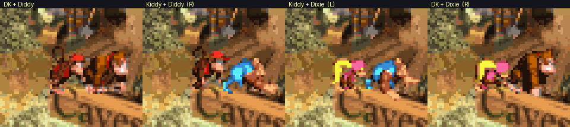
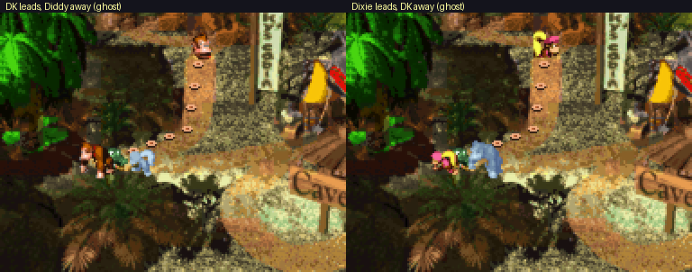
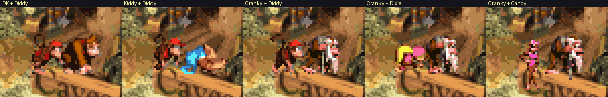
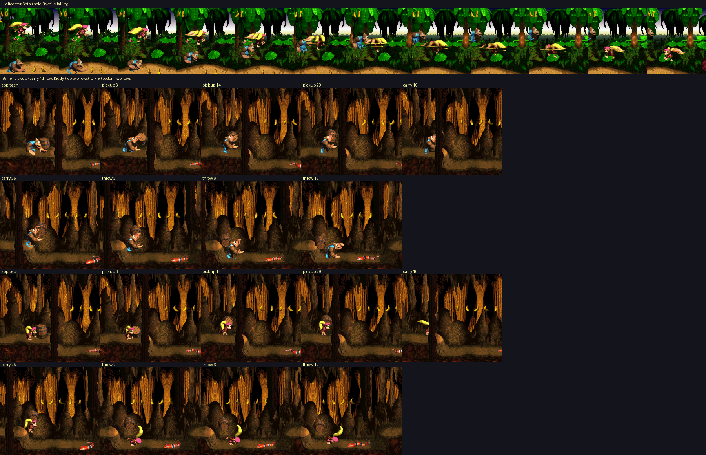
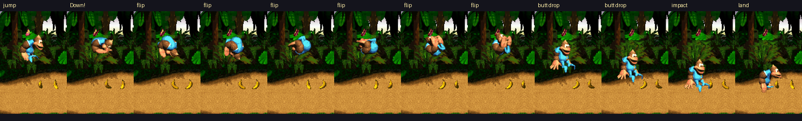
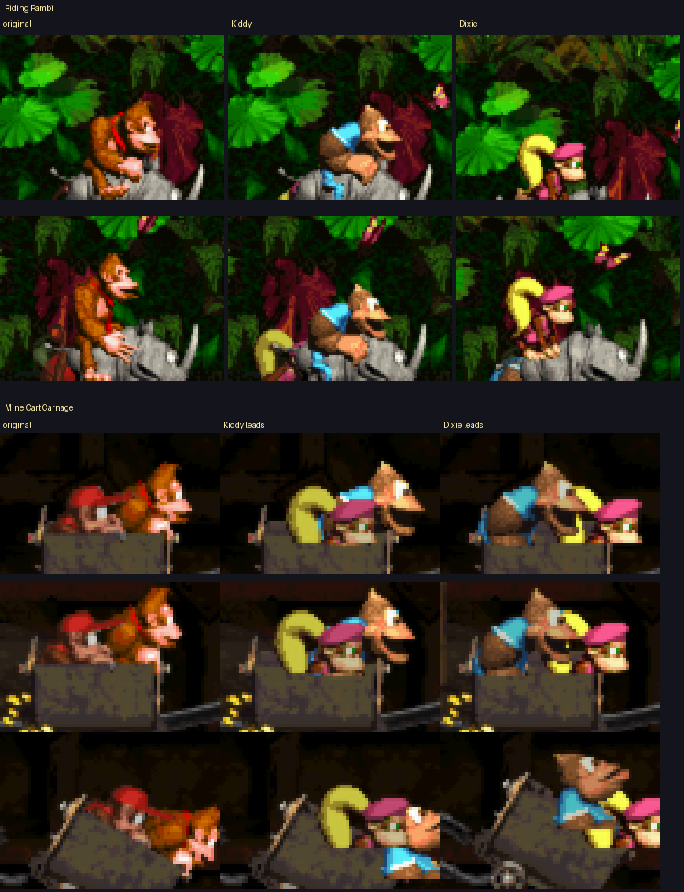
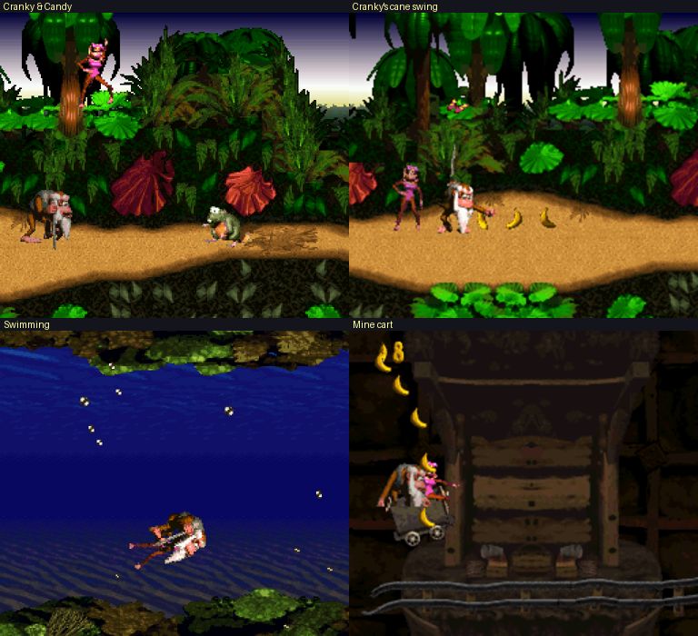
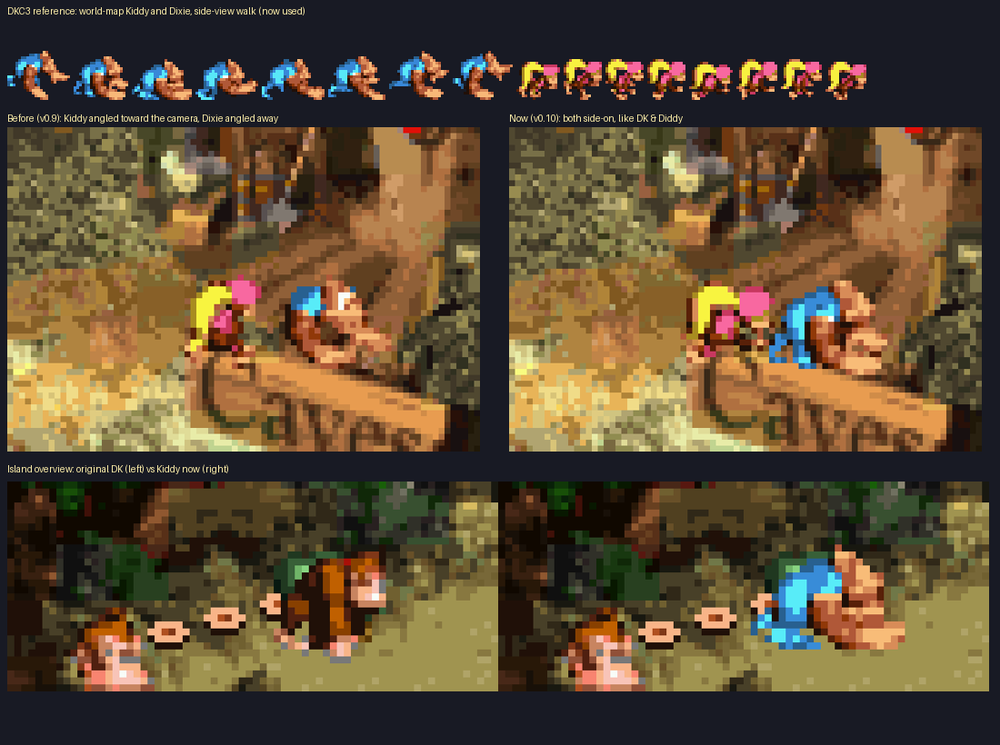
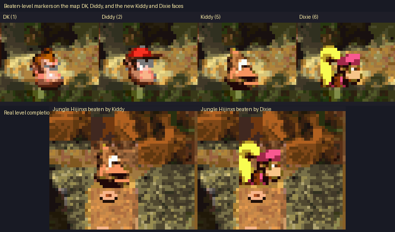

# Donkey Kong Country: Kong Swap

A ROM hack of **Donkey Kong Country** (SNES, USA v1.0) that adds **Kiddy Kong** (from DKC3), **Dixie Kong** (from DKC2), **Cranky Kong** and **Candy Kong** as playable characters. On the world map, **R cycles DK → Kiddy → Cranky** and **L cycles Diddy → Dixie → Candy**, so you can play as any of the nine pairs.





## Features

- **Pick each Kong independently any time on the world map**: **R** cycles the lead Kong (DK → Kiddy → Cranky) and **L** cycles the partner (Diddy → Dixie → Candy). Both Kongs on the map update right away. DK & Diddy stay exactly as in the original game.
- **Cranky Kong** (new in 3.0) uses DKC1's own Cranky art, including his unused walk cycle. He **swings his cane** instead of rolling.
- **Candy Kong** (new in 3.0) uses her DKC1 art plus newly made walking, running, jumping, swimming, climbing and carrying frames. Her attack is a **blown kiss**, she bends over (her kiss pose) to crouch, and she swoons when hit.
- **Both Kongs always appear on the world map.** If one of them is missing (lost in a level, or Diddy still captured at the start), they follow along as a pale **ghost**, so you can always see which two Kongs you have picked.
- **Dixie's Helicopter Spin**: jump (or walk off a ledge), then hold **B** to twirl her ponytail and float down.
- **Kiddy's Ground Pound**: press **Down** in mid-air. He pauses, flips, and slams down butt-first.
  - Shatters hidden bonus-room walls (the ones Rambi or a barrel would break).
  - Pops buried items out of the ground (the spots DK's hand slap opens).
  - Hold Down after landing to stay seated.
- **Full sprite sets** from DKC2/DKC3 for walking, running, jumping, rolling, swimming, ropes, barrels, hurt and victory.
- **Riding animal buddies** (Rambi, Expresso, Winky, Enguarde) and **mine carts**.
- **World map and island sprites** for both Kongs, plus their **faces on beaten levels**.
- **Correct colours everywhere**, including dark, rainy, lightning and murky-water levels, Cranky's, Funky's, Candy's, and the extra-life balloon.








## Playing it

1. Get a **clean, headerless** dump of *Donkey Kong Country (USA) v1.0* from a cartridge you own.
   SHA-256: `fa8cacf5bbfc39ee6bbaa557adf89133d60d42f6cf9e1db30d5a36a469f74d15`
2. Apply [`patches/dkc1_kong_swap_v3.1.bps`](patches/dkc1_kong_swap_v3.1.bps) (recommended, because it checks that you used the right ROM) or [`patches/dkc1_kong_swap_v3.1.ips`](patches/dkc1_kong_swap_v3.1.ips) (for patchers that only support IPS) with [Floating IPS](https://www.smwcentral.net/?p=section&a=details&id=11474) or [Rom Patcher JS](https://www.marcrobledo.com/RomPatcher.js/).
3. Play in any accurate SNES emulator (tested in snes9x and bsnes).

The patched ROM is 8 MB (ExHiROM). The v1.0 patches (which switch both Kongs together with L or R) are still in `patches/`. Older versions are on the Releases page.

**No ROMs are included in this repository, and please don't open issues or pull requests containing ROMs.**

## Building from source

The hack is built from your own copies of all three games. The Kiddy and Dixie graphics are read straight out of your DKC2 and DKC3 ROMs.

Requirements: Python 3.9+, `pip install -r requirements.txt`, and [asar](https://github.com/RPGHacker/asar) v1.9+ on your `PATH` (or set `ASAR=/path/to/asar`).

Put your clean, headerless USA ROMs in `roms/`:

| File | Game | SHA-256 |
|---|---|---|
| `roms/dkc1.sfc` | Donkey Kong Country (USA) v1.0 | `fa8cacf5…f74d15` |
| `roms/dkc2.sfc` | Donkey Kong Country 2 (USA) (En,Fr) | `35421a9a…8d8633` |
| `roms/dkc3.sfc` | Donkey Kong Country 3 (USA) (En,Fr) | `2277a2d8…94a32b` |

Then run:

```sh
python3 tools/build.py
```

This writes `build/dkc1_kong_swap.sfc`, `build/dkc1_kong_swap.bps` and `build/dkc1_kong_swap.ips`. The build is deterministic, so with the correct ROMs it reproduces the released patch byte for byte. You can also point to the ROMs with the `DKC1_ROM`, `DKC2_ROM` and `DKC3_ROM` environment variables.

### How it works

- `src/kong_swap.asm`: all new 65816 code (assembled with asar). It covers the per-Kong switches (three choices each), the alternate frame-table and palette lookups, the map hooks, the helicopter spin, the ground pound, held-barrel placement and the level-complete faces.
- `tools/build.py`: expands DKC1 to 8 MB ExHiROM. It builds alternate sprite-frame tables (one per new Kong) where DK/Diddy poses point at matching Kiddy, Dixie, Cranky or Candy poses, then copies, realigns and recomposes the frames, adds the palettes, and assembles the code.
- `tools/candy_rig.py`, `tools/candy_poses.py`, `tools/puppet.py`: cut Candy's standing frame into limbs and pose them to make her new frames. `tools/ccmap.py` maps every DK/Diddy animation to a Cranky/Candy one, and `tools/enc.py` packs frames into the 32-tile VRAM slot.
- `data/`: frame names and offsets only (no game graphics).

The original code and data are left untouched except for small hooks, and DK & Diddy use the original tables.

## Known limitations

- The Kong choice resets to DK & Diddy when the console is powered off, though it survives soft resets and save/continue within a session.
- Neither DKC2 nor DKC3 has art of Dixie riding an animal or a cart, so she uses one seated pose for those.
- Candy's new frames are made from her standing pose, so they look stiffer than Rare's art. She is shown at two-thirds of her DKC1 size, which is still a little taller than Diddy, while her hitbox stays Diddy-sized.
- Cranky has no swimming or climbing art, so those poses are built from his walk and arms-up frames.
- Some uncommon poses borrow the closest available animation.
- On real hardware, pressing L/R on the map may show a one-frame line while the map colours update.

## Credits

- Donkey Kong Country 1–3 © Nintendo / Rare. This is an unofficial fan project, not affiliated with or endorsed by Nintendo or Rare. All game graphics are read from the user's own ROMs at build time.
- [Yoshifanatic1's DKC1 disassembly](https://github.com/Yoshifanatic1/Donkey-Kong-Country-1-Disassembly) (GPL-3.0): routine, RAM and graphic names.
- [DKC1Recomp](https://github.com/elliotttate/DKC1Recomp) (MIT): the Kiddy frame map (`data/kiddy_frames.inc`).
- [DKC2Recomp](https://github.com/elliotttate/DKC2Recomp) and [DKC3Recomp](https://github.com/elliotttate/DKC3Recomp): reference for DKC2/DKC3 animation formats.
- p4plus2's DKC2 disassembly: sprite notes.
- [asar](https://github.com/RPGHacker/asar), [snes9x](https://github.com/snes9xgit/snes9x) and [bsnes](https://github.com/bsnes-emu/bsnes): assembling and testing.

## License

The code in this repository is released under the **GNU GPL v3.0** (see `LICENSE`). Game content is not covered by this license.
